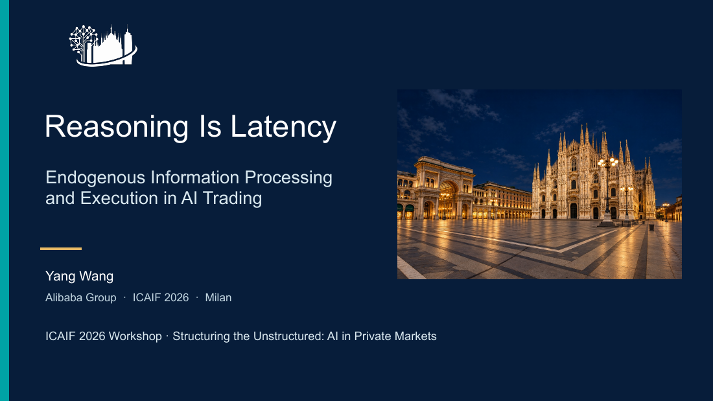

  
Engineering · Quantitative finance · Machine learning

  
I am a Senior Site Reliability Engineer at <strong>Alibaba Group</strong> and an independent researcher in quantitative finance.

  
My work spans large-scale systems and machine learning, with research interests in derivatives pricing, market microstructure, volatility modeling, and model uncertainty.

  
<a class="site-button" href="/publications/">Explore publications</a><a class="site-button secondary" href="/year-archive/">Read the research blog</a>

<section class="home-section" aria-labelledby="seminar-heading">
  

Conference &amp; presentation<h2 id="seminar-heading">Seminar</h2>

  

    
ICAIF ’26 · Milan · 14–17 November 2026

    <h3>7th ACM International Conference on AI in Finance workshop</h3>
    
Best Paper Award

    <h4>Reasoning Is Latency: Endogenous Information Processing and Execution in AI Trading</h4>
    
Oral presentation on November 15 · Submission ID: 1235

    
Presented at the <a href="https://ai-private-markets.github.io/ai-for-private-market-workshop/">Structuring the Unstructured: AI in Private Markets workshop</a>. Thanks to the committee, including <a href="https://www.linkedin.com/in/dhagash-mehta-ph-d-45000111a/">Dr. Dhagash Mehta</a> and <a href="https://www.linkedin.com/in/jingrao-lyu/">Jingrao (Jasmine) Lyu</a>.

    

About the workshop

The workshop brings together researchers and practitioners to explore AI across private markets, including agentic workflows, foundation models for diligence, fragmented data, trustworthy decision-making, and the challenges of evaluation with delayed outcomes and uncertain valuations.

    

<strong>Presentation slides</strong>
View the conference presentation as a PDF.
<a class="text-link" href="/files/ICAIF_2026_Reasoning_Is_Latency_Stage.pdf">Open presentation PDF</a>

    

Preview the slides here
<iframe src="/files/ICAIF_2026_Reasoning_Is_Latency_Stage.pdf" title="Reasoning Is Latency presentation slides" loading="lazy"></iframe>

  

</section>

<section class="home-section" aria-labelledby="works-heading">
  

Selected research<h2 id="works-heading">Recent Works</h2>
<a href="/publications/">All publications</a>

  

    <article>Working paper · 2026<h3><a href="/publication/2026-04-01-smart-order-routing/">AI-Powered Smart Order Routing and the New Best Execution Problem</a></h3>
Examines execution cost improvements alongside routing concentration and systemic risk.
<a href="/files/smart_order_routing.pdf">PDF</a></article>
    <article>Working paper · 2026<h3><a href="/publication/2026-06-01-hard-constrained-inverse-diffusion/">Hard-Constrained Structure-Preserving Learning for Inverse Diffusion</a></h3>
A differentiable Galerkin approach to option calibration with structural guarantees.
<a href="/files/hard_constrained_inverse_diffusion.pdf">PDF</a></article>
    <article>Working paper · 2026<h3><a href="/publication/2026-07-01-nonlinear-price-impact/">Learning State-Dependent Nonlinear Price Impact from Exogenous Demand Shocks</a></h3>
Studies nonlinear price impact as a measure of liquidity and dealer constraints.
<a href="/files/npiml.pdf">PDF</a></article>
    <article>Working paper · 2026<h3><a href="/publication/2026-08-01-order-books-vs-liquidity-pools/">Order Books vs. Liquidity Pools</a></h3>
Compares price discovery and execution across centralized and decentralized markets.
<a href="/files/order_books_vs_liquidity_pools.pdf">PDF</a></article>
  

</section>

<section class="home-section" aria-labelledby="blog-heading">
  

Ideas &amp; analysis<h2 id="blog-heading">Research Blog</h2>
<a href="/year-archive/">All posts</a>

  

    <a href="/posts/2026/08/series-ai-trading-agents/">01<h3>AI Trading Agents &amp; Market Microstructure</h3>
Reasoning latency, market makers and routing.
</a>
    <a href="/posts/2026/07/series-dealer-balance-sheet/">02<h3>Dealer Balance Sheet &amp; Treasury Liquidity</h3>
Risk limits, clearing and market resilience.
</a>
    <a href="/posts/2026/06/series-ml-liquidity-measures/">03<h3>Machine-Learned Liquidity &amp; Causal Inference</h3>
Market quality, liquidity and causal designs.
</a>
  

</section>

<section class="home-section" aria-labelledby="interests-heading">

Areas of inquiry<h2 id="interests-heading">Research Interests</h2>

Derivatives pricing and volatility surfaces · Stochastic models and uncertainty quantification · Information geometry · AI and market microstructure
</section>
<section class="home-section" aria-labelledby="background-heading">

Background<h2 id="background-heading">Experience &amp; Education</h2>
<a href="/cv/">View CV</a>

<strong>Alibaba Cloud Computing</strong> Senior Engineer · 2021–Present

<strong>Wuhan University</strong> M.E. Electronic and Communication Engineering · 2019–2021

<strong>Wuhan University of Technology</strong> B.E. Communication Engineering · 2015–2019

</section>
